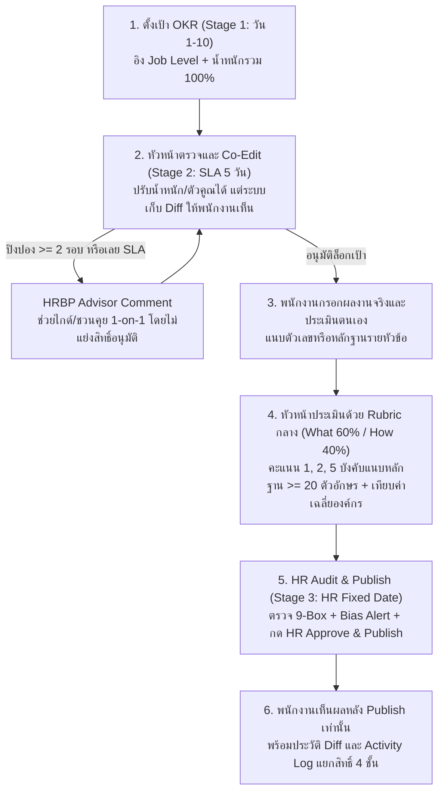

# ทฤษฎีความโปร่งใส จุดเกิดการโกง การเทียบกับ SAP และแนวทางปิด Gen-Gap สำหรับ empeo

เอกสารนี้รวบรวมกรอบคิดเชิงทฤษฎีด้านความยุติธรรมในองค์กร (Organizational Justice), แผนที่จุดเกิดการโกงและอคติในระบบประเมินผลงาน, ข้อแตกต่างระหว่างเว็บ empeo ของเรากับ SAP SuccessFactors หรือระบบองค์กรดั้งเดิม และแนวทางออกแบบระบบให้พนักงานทุกแผนกทุกวัยใช้งานได้ทันทีโดยแทบไม่ต้องเรียนรู้ใหม่

## 1. เชิงทฤษฎี: Logical Workflow แบบไหนถึงจะเรียกว่า "โปร่งใส" จริง

ในงานวิจัยด้านจิตวิทยาองค์กรของ Greenberg (1987) และ Colquitt (2001) ความรู้สึกว่า "การประเมินนี้ยุติธรรมและโปร่งใส" ประกอบด้วย 3 แกนหลัก ถ้าขาดแกนใดแกนหนึ่ง พนักงานจะรู้สึกว่าถูกเอาเปรียบแม้ตัวเลขจะคำนวณถูกก็ตาม

1. ความยุติธรรมของผลลัพธ์ (Distributive Justice): คนที่ทำงานได้ผลลัพธ์สูงและมีพฤติกรรมดีควรได้คะแนนสูงกว่าคนที่ทำไม่ได้ตามเป้าอย่างชัดเจน
2. ความยุติธรรมของกระบวนการ (Procedural Justice): ทุกคนถูกวัดด้วยกติกาเดียวกันตั้งแต่วันแรก ไม่มีใครแอบเปลี่ยนตัวชี้วัดกลางทาง มีกำหนดเวลาชัด และมีช่องทางทักท้วงหรือขอความช่วยเหลือเมื่อเห็นไม่ตรงกัน
3. ความยุติธรรมในการสื่อสารและข้อมูล (Informational Justice): เมื่อผลออกมาแล้ว พนักงานเห็นเหตุผลและหลักฐานประกอบ ไม่ใช่เห็นแค่ตัวเลข 3/5 ลอยๆ ที่ไม่รู้ว่าหักคะแนนตรงไหน

งานวิจัยของ Scullen, Mount และ Goff (2000) ในวารสาร Journal of Applied Psychology พบว่า 53% ถึง 62% ของความต่างของคะแนนประเมินมาจากตัวผู้ประเมินเอง (Idiosyncratic Rater Effect) ส่วนผลงานจริงของพนักงานมีผลแค่ 21% ถึง 25% ดังนั้น ระบบจะโปร่งใสไม่ได้ถ้าปล่อยให้หัวหน้าแต่ละคนตีความคะแนน 1 ถึง 5 เอาเอง

### โครงสร้าง Logical Workflow ที่ปิดช่องว่างทั้ง 3 แกน

หลักการสำคัญของ Workflow นี้มี 4 ข้อ:
- ล็อกกติกาก่อนเริ่มงาน (Ex-ante Alignment): ตกลงตัวชี้วัด น้ำหนัก และความยากตาม Job Level ตั้งแต่ต้นรอบ
- บังคับแยก "ผลงาน (What)" ออกจาก "พฤติกรรม (How)": กันไม่ให้คนทำยอดเก่งแต่ทำลายทีมได้คะแนนเต็ม หรือคนคุยเก่งแต่ไม่ส่งงานได้คะแนนสูง
- ป้องกันอคติที่ต้นทางก่อนส่ง (Preventive Gate): บังคับแนบหลักฐานเมื่อให้คะแนนสุดโต่ง (1, 2, 5) และโชว์ค่าเฉลี่ยทีมเทียบค่าเฉลี่ยองค์กรทันทีตอนหัวหน้ากำลังกดคะแนน
- แยกสิทธิ์การมองเห็นแบบล็อกฝั่งเซิร์ฟเวอร์ (Strict Privacy Boundary): คะแนนร่างของหัวหน้าและธง Bias Alert ของ HR ห้ามหลุดถึงพนักงานก่อนวันประกาศผล เพื่อกันความขัดแย้งระหว่างทาง

## 2. ความไม่โปร่งใสและความขี้โกงเกิดขึ้นได้ยังไง ตอนไหน และทำไมระบบเดิมถึงจับไม่ได้

ตามกฎของ Goodhart (Goodhart's Law) เมื่อตัวชี้วัดถูกผูกกับโบนัสหรือการเลื่อนตำแหน่ง คนจะเริ่มเล่นเกมกับตัวชี้วัดแทนที่จะทำงานให้เกิดผลลัพธ์จริง ความไม่โปร่งใสไม่ได้เกิดแค่ตอนให้คะแนนปลายปี แต่แทรกอยู่ทุกช่วงของ Workflow

| ช่วงของ Workflow | รูปแบบความไม่โปร่งใส / การโกงที่เกิดจริง | ทำไมระบบเดิม (Excel / Email / ERP เก่า) ถึงจับไม่ได้ | กลไกใน empeo ที่ช่วยดักจับ |
| :--- | :--- | :--- | :--- |
| 1. ช่วงตั้งเป้า (OKR Setting) | **Sandbagging (กั๊กเป้า):** ตั้งเป้าง่ายๆ เช่น ตั้งเป้ายอดขายต่ำกว่าปกติเพื่อให้ทำได้ 100% เต็ม หรือเทน้ำหนัก 70% ไปงานรูทีนที่ทำเสร็จแน่ๆ | Excel ไม่มีข้อมูล Job Level เทียบข้างกัน และไม่มีประวัติว่าตอนแรกเสนออะไรแล้วแก้กี่รอบ | โชว์ป้าย **Job Level (L1-L4)** คู่หัวข้อ OKR และให้หัวหน้า **Co-Edit น้ำหนัก/ตัวคูณ** ได้ตรงตอนอนุมัติ |
| 2. ระหว่างปี (Mid-Cycle) | **Silent Goal Editing (แอบแก้เป้าเงียบๆ):** หัวหน้ากับลูกน้องสนิทกันแอบลดเป้าตอนใกล้สิ้นปี หรือหัวหน้าเปลี่ยนเป้าโดยพนักงานไม่รู้ตัว | ไฟล์ Excel ส่งไปมาในอีเมล ไม่มี Version Lock และไม่มี Diff log ว่าใครแก้เลขจากอะไรเป็นอะไร | ล็อกเป้าทันทีหลัง `GOAL_APPROVED` และบันทึก **Before/After Diff** ทุกครั้งที่แก้ลง Comment History และ Activity Log |
| 3. ช่วงประเมินตนเอง (Self-Review) | **Recency Bias & Credit Stealing:** ยกเฉพาะงานเด่น 2 เดือนสุดท้ายมาเขียน หรือเคลมผลงานทั้งทีมเป็นผลงานคนเดียว | ช่องกรอกเป็นกล่องข้อความว่างยาวๆ ไม่มีกรอบให้เทียบกับ Target ที่ตกลงไว้ตอนต้นปี | แสดง Target ที่ล็อกไว้เทียบคู่กับ Actual และ Progress % รายหัวข้อ พร้อมให้หัวหน้าตีกลับขอหลักฐานเพิ่มได้ |
| 4. ช่วงหัวหน้าให้คะแนน (Manager Evaluation) | **Leniency Bias (แจก 5 ยกทีมหนีปัญหา), Severity Bias (กดคะแนน), Halo Effect (รักใครให้สูง), Central Tendency (จิ้ม 3 ทุกคนให้จบไว)** | ระบบเก่าปล่อยให้คลิกตัวเลข 1-5 ได้โดยไม่ต้องใส่เหตุผล และหัวหน้าไม่เห็นว่าคะแนนทีมตัวเองเพี้ยนจากทีมอื่นแค่ไหน | **Behavioral Anchor Rubric** ข้างปุ่มคะแนน + **Evidence Gate** (1, 2, 5 ต้องเขียนหลักฐาน >= 20 ตัวอักษร) + **Live Team vs Org Benchmark** + **Bias Alert** |
| 5. ช่วงปิงปอง / ส่งช้า (SLA & Exceptions) | **Bureaucratic Stalling (ดองเอกสาร):** หัวหน้าหรือพนักงานตีกลับไปมาไม่รู้จบ หรือปล่อยเลยกำหนดจน HR ต้องยอมปล่อยผ่านแบบลวกๆ | ไม่มี Stage SLA แยกช่วง HR มารู้ตัวอีกทีคือวันสุดท้ายก่อนจ่ายโบนัส แก้ไม่ทันแล้ว | **3-Stage Due Dates** + แจ้งเตือน **HRBP Advisor** อัตโนมัติเมื่อเลย SLA 5 วัน หรือปิงปองตั้งแต่รอบที่ 2 ขึ้นไป |
| 6. ช่วงก่อนประกาศผล (Release) | **Black-Box Override & Score Leak:** ผู้บริหารแอบปรับลดคะแนนหลังบ้านโดยไม่มีบันทึก หรือพนักงานรู้คะแนนก่อนวันประกาศจริงจนเกิดดราม่าข้ามทีม | ไฟล์ Excel รวมคะแนนส่งต่อกันในแชทหรือเมล หลุดง่าย และไม่มี Audit Log แยกสิทธิ์การมองเห็น | **Server-Side Publish Gate** (`sanitizeReviewForRole` ตัดคะแนนทิ้ง 100% จนกว่า `PUBLISHED`) + **Activity Log แยกสิทธิ์ 4 ชั้น** + `409` State Guard ห้ามแก้เคสที่ประกาศผลแล้ว |

สรุป 4 รากเหง้าที่ทำให้ระบบดั้งเดิมจับการโกงไม่ได้:
1. ข้อมูลไม่มีโครงสร้าง (Unstructured Free-Text): ตัวเลขกับเหตุผลกระจัดกระจายอยู่ในไฟล์ Word/Excel ทำให้เทียบข้ามทีมไม่ได้
2. ไม่มีฐานเทียบข้ามองค์กร (No Real-Time Baseline): HR มักมาเห็นว่าแผนกขายแจก 5 ยกทีมก็ต่อเมื่อถึงวันปิดรอบแล้ว
3. แก้ไขย้อนหลังได้โดยไร้ร่องรอย (Mutable History): ใครแก้ตัวเลขน้ำหนักหรือคะแนนเมื่อไร ไม่มี Audit Log และไม่มี Diff
4. ระบบใช้งานยากเกินไป (High Friction): เมื่อการกรอกแต่ละครั้งกินเวลาหลายชั่วโมง ทั้งพนักงานและหัวหน้าจึงเลือกวิธีลัด (จิ้ม 3 ทุกคน หรือก๊อปข้อความเดิมมาแปะ) เพื่อรีบปิดงาน

## 3. เว็บ empeo ที่เราเขียนตอนนี้ ต่างจาก SAP SuccessFactors และระบบดั้งเดิมยังไง

การเปรียบเทียบอย่างตรงไปตรงมาทั้งจุดแข็งและข้อจำกัดช่วยให้เห็นตำแหน่งผลิตภัณฑ์ชัดขึ้น

| มิติเปรียบเทียบ | SAP SuccessFactors / Workday / ERP ดั้งเดิม | empeo Performance Prototype ของเรา |
| :--- | :--- | :--- |
| แนวคิดการออกแบบ | **Compliance & Record-Keeping:** ออกแบบให้ HR เก็บข้อมูลครบตามกฎหมายและผูกฐานเงินเดือน/บัญชีขององค์กรข้ามชาติ | **Preventive Fairness & Speed:** ออกแบบให้ดักอคติและแก้ปัญหาการประเมินตั้งแต่ระหว่างกรอก ลดดราม่าและลดงานเอกสาร |
| การป้องกันอคติ (Bias) | ส่วนใหญ่ทำเป็น **Post-hoc Calibration** (รอให้หัวหน้ากรอกเสร็จหมดก่อน แล้วค่อยเอาข้อมูลมาเปิดห้องประชุมถกกันทีหลัง) | ดักตั้งแต่ตอนกรอกด้วย **Evidence Guardrail** + **Live Team vs Org Benchmark** + **Bias Alert** อัตโนมัติ |
| ความซับซ้อนในการใช้งาน | ฟอร์มยาว 30-50 ช่อง เมนูซ้อนหลายชั้น มีศัพท์ HR เฉพาะทางสูง ต้องจัดอบรมหรือมีตัวแทนแผนกมาสอนพนักงาน | รวม Flow หลักไว้ในหน้าเดียวต่อบทบาท โหลดทันที (`0ms`) แปลภาษา EN/ไทยธรรมชาติ และไม่มีชื่อ Enum หรือศัพท์เทคนิคหลุดหน้าจอ |
| การแก้เคสค้าง / ปิงปอง | มักตั้งเส้นตายรวมวันเดียวปลายรอบ หรือส่งอีเมลเตือนซ้ำๆ จนคนเมิน | แยก **3-Stage Due Dates** พร้อมป้ายนับถอยหลัง/เลยกำหนด/เสร็จก่อนกำหนด และเรียก **HRBP Advisor** ลงมาช่วยไกล่เกลี่ยเมื่อปิงปอง >= 2 รอบ |
| ความโปร่งใสของการแก้เป้า | การปรับน้ำหนักหรือแก้ไขเป้ามักเขียนทับค่าเดิม หรือซ่อนอยู่ใน Log ฝั่ง Admin ที่พนักงานมองไม่เห็น | หัวหน้า **Co-Edit น้ำหนัก/ตัวคูณ** ได้ทันทีตอนอนุมัติ และระบบเขียน Diff แจ้งพนักงานในประวัติอย่างเปิดเผย |
| จุดที่ SAP ยังเหนือกว่า (พูดตรงๆ) | รองรับกฎหมายแรงงานหลายประเทศ, โครงสร้างบริษัทในเครือซับซ้อน, เชื่อม Payroll/Merit Matrix/Succession Planning ครบวงจรในตัว | ตอนนี้เป็น v1 Prototype ที่เน้นหัวใจเรื่องความยุติธรรมและการใช้งานจริง ยังไม่ได้เชื่อมระบบจ่ายเงินเดือนอัตโนมัติหรือ Multi-Entity ERP |

## 4. แนวทางปิด Gen-Gap และออกแบบให้เป็น "Zero-Learning-Curve" (ใช้เป็นทันทีโดยไม่ต้องอบรม)

เป้าหมายของคุณคือให้พนักงานทุกวัย (ตั้งแต่เด็กจบใหม่จนถึงพนักงานอาวุโสที่ไม่ถนัดไอที) และทุกแผนก (ขาย, ไอที, ธุรการ, บัญชี, ผลิต, บริการลูกค้า) ทำงานบนระบบนี้จบได้ใน 5 ถึง 10 นาที โดยไม่ต้องส่งตัวแทนไปเรียนแล้วกลับมาสอนต่อ และไม่ต้องนั่งบวกลบตัวเลขหลายชั้น

ด้านล่างคือ 7 กลไกที่ทำได้จริงบน empeo เพื่อกำจัด Pain Point เหล่านี้โดยไม่ทำลายความยุติธรรมของระบบ

### 1. เปลี่ยนการกรอกค่าน้ำหนัก % เอง เป็นปุ่ม "ระดับความสำคัญ" + ปรับครบ 100% อัตโนมัติ
- ปัญหาเดิม: พนักงานเสียเวลานั่งบวกลบเลข เช่น ข้อ 1 ใส่ 35%, ข้อ 2 ใส่ 40%, ข้อ 3 เหลือเท่าไร? พอแก้ข้อหนึ่งต้องกลับไปแก้ทุกข้อให้รวมครบ 100%
- วิธีแก้:
  - ให้พนักงานเลือกแค่ **"งานหลัก (สำคัญมาก)" / "งานสำคัญปกติ" / "งานเสริม"** (3 ปุ่มชัดๆ) แล้วระบบคำนวณสัดส่วน `%` ให้ครบ 100% อัตโนมัติทันที
  - มีปุ่ม **"ปรับสัดส่วนให้ครบ 100% อัตโนมัติ (Auto-Balance)"** เผื่อคนอยากใส่เลขเองแต่ไม่อยากคำนวณเศษ
  - ซ่อนค่า **Multiplier (1.0x / 1.1x / 1.2x)** ไว้เป็นภาษาคน เช่น `งานมาตรฐาน` / `งานท้าทายกว่าปกติ` / `งานโปรเจกต์พิเศษ` (หรือให้หัวหน้าเป็นคนปรับในขั้นตอนอนุมัติ พนักงานไม่ต้องปวดหัวเลือกตัวคูณเอง)

### 2. มี "ชุดเป้าหมายสำเร็จรูปตามแผนก" (Department Starter Templates) กด 1 คลิกแล้วแก้แค่ตัวเลข
- ปัญหาเดิม: พนักงานส่วนใหญ่จ้องหน้าจอว่างๆ แล้วนึกไม่ออกว่าจะเขียนหัวข้อ OKR ยังไงให้ถูกหลัก
- วิธีแก้: ตอนกด "เพิ่ม OKR" ให้มีปุ่มเลือก Template สำเร็จรูปแยกตามแผนกและลักษณะงาน เช่น:
  - **ฝ่ายขาย / การตลาด:** ปิดยอดขายตามเป้า, รักษาฐานลูกค้าเดิม, จำนวนลูกค้าใหม่
  - **ฝ่ายปฏิบัติการ / ธุรการ / บัญชี / HR:** ส่งรายงานหรือเอกสารตรงเวลาครบทุกรอบ, ลดข้อผิดพลาดเอกสาร, ความพึงพอใจของผู้รับบริการภายใน
  - **ฝ่ายบริการลูกค้า (CS / Support):** แก้ไขเคสลูกค้าภายใน SLA, คะแนนความพึงพอใจลูกค้า
  - **ฝ่ายเทคนิค / โปรดักต์:** ส่งมอบฟีเจอร์ตามแผน, ลดบั๊กหรือเวลาล่มของระบบ
  - พนักงานคลิกเลือก 1 อัน ระบบเติมหัวข้อและหน่วยวัดให้ทันที เหลือแค่แก้ตัวเลขเป้าหมายให้ตรงงานตัวเอง ลดเวลาจาก 2 ชั่วโมงเหลือไม่ถึง 5 นาที

### 3. รองรับวิธีวัดผล 3 แบบตามธรรมชาติงานจริง (ไม่ต้องฝืนแปลงทุกงานเป็นตัวเลขซับซ้อน)
- งานแต่ละแผนกวัดเหมือนกันไม่ได้ ถ้าบังคับให้ใส่ `Target Value + Unit` แบบเดียวกันหมด พนักงานสายสนับสนุนจะงงและกรอกมั่ว
- วิธีแก้: ให้เลือกโหมดวัดผลแบบเข้าใจง่าย 3 แบบ:
  1. **แบบตัวเลข (Numeric):** เช่น ขายได้ 12 ล้านบาท, ตอบลูกค้าภายใน 24 ชม.
  2. **แบบเช็กลิสต์ผลงานสำเร็จ (Milestone / Checklist):** เช่น ทำคู่มือเสร็จ, ส่งงบครบ 12 เดือน (เหมาะมากสำหรับธุรการ บัญชี HR และพนักงานอาวุโสที่คุ้นเคยกับการติ๊กงานเสร็จ)
  3. **แบบคุณภาพ / มาตรฐานบริการ (Quality Standard):** เช่น คะแนนประเมินจากลูกค้าหรือเพื่อนร่วมงาน >= 4/5

### 4. แสดงป้าย "ตอนนี้ตาใครต้องทำอะไร" (Single Next-Action Banner) บนสุดของหน้า
- ปัญหาเดิม: พนักงานอาวุโสเปิดระบบแล้วงงว่าตกลงต้องกดปุ่มไหน หรือส่งไปแล้วหรือยัง ทำไมกดแก้ไม่ได้
- วิธีแก้: ใส่กล่องข้อความเดียวชัดๆ ด้านบนสุดของหน้า Employee และ Manager เช่น:
  - `ตาคุณตอนนี้: เพิ่ม OKR ให้ครบ 100% แล้วกดปุ่มสีน้ำเงิน "ส่งให้หัวหน้าอนุมัติ"`
  - `เรียบร้อยแล้ว! ตอนนี้รอคุณซาร่า (หัวหน้าของคุณ) ตรวจสอบภายใน 23 พ.ย. คุณยังไม่ต้องทำอะไรเพิ่ม`
  - ลดความกังวลว่า "กดส่งไปหรือยัง" หรือ "ทำพังไหม" ลงได้ทันที

### 5. ช่วยเขียนผลงานและหลักฐานด้วย "3 คำถามนำสั้นๆ" แทนช่องว่างเปล่า
- ปัญหาเดิม: พนักงานใหม่และพนักงานอาวุโสกลัวการเขียนเรียงความในช่อง Evidence หรือ Self-Reflection
- วิธีแก้: ในช่องกรอกผลงาน มีชิปปุ่มช่วยเริ่มประโยค (Quick Prompts) หรือไกด์ 3 บรรทัดสั้นๆ:
  - ทำอะไรเสร็จไปบ้าง?
  - ผลลัพธ์ที่ได้คืออะไร (ตัวเลข / ตัวอย่างงาน)?
  - มีเรื่องไหนที่ติดขัดและอยากให้ช่วย?

### 6. ออกแบบรองรับ Gen-Gap โดยตรง ("อ่านง่าย กดไม่พลาด ไม่กลัวทำข้อมูลหาย")
- **Auto-Save ตลอดเวลา:** พิมพ์ค้างไว้แล้วปิดเครื่องหรือเน็ตหลุด กลับมาเปิดใหม่ข้อมูลยังอยู่ครบ พร้อมป้ายเล็กๆ `บันทึกอัตโนมัติเมื่อสักครู่`
- **โหมดตัวหนังสืออ่านง่าย (Comfortable Typography):** ตัวอักษรขนาดมาตรฐาน `16px+`, Contrast สูงผ่าน WCAG AA, ปุ่มขนาดใหญ่ `>= 44px`, และใช้สีคู่กับข้อความและไอคอนเสมอ (ไม่ใช้สีอย่างเดียว)
- **ภาษาไทยธรรมดา 100%:** ไม่มีศัพท์ HR ฝรั่งหรือศัพท์ไอทีโผล่ในหน้าใช้งานประจำวันของพนักงาน เช่น แทนที่จะเขียน `Weight`, `Multiplier`, `SLA Breach`, `Calibration` ให้ใช้คำที่คนทำงานจริงพูดกัน เช่น `ความสำคัญของงาน`, `ระดับความท้าทาย`, `เลยกำหนดส่ง`, `รอ HR ตรวจสอบ`
- **Undo / Preview ก่อนส่งจริง:** ก่อนกดส่งให้หัวหน้า แสดงหน้าสรุปสั้นๆ 1 หน้าให้ตรวจทานก่อนกดยืนยัน เพื่อไม่ให้ผู้ใช้งานที่ไม่ถนัดไอทีกลัวการกดพลาด

### 7. ไม่ต้องจัดอบรมหรือส่งตัวแทนไปเรียน (Built-in 30-Second Contextual Tips)
- แทนที่จะทำคู่มือ PDF 30 หน้า ให้ใส่คำอธิบายสั้นๆ 1 บรรทัดใต้หัวข้อสำคัญเฉพาะตอนที่กำลังทำขั้นนั้นอยู่ (Progressive Disclosure)
- สิ่งที่ยังไม่ถึงคิว (เช่น ฟอร์มประเมินตนเองตอนที่ OKR ยังไม่อนุมัติ) ให้ซ่อนหรือพับไว้ก่อน เพื่อไม่ให้หน้าจอรกด้วยช่องกรอก 40 ช่องพร้อมกันเหมือนระบบ ERP เก่า

## 5. แผนต่อยอดสำหรับรอบหน้า (เรียงลำดับตามความคุ้มค่า)

ถ้าจะเอาแนวคิด Zero-Learning-Curve นี้ไปปรับลงใน empeo Prototype รอบถัดไป (ควบคู่กับโน้ต 3 ข้อก่อนหน้า) แนะนำทำเป็น 3 ขั้นเล็กๆ ที่เห็นผลทันทีตอนพรีเซนต์:

1. **ขั้นที่ 1 (จัดระเบียบสายตาและลดความกลัวกดผิด):** ย้าย Activity Log ลงด้านล่างสุดทุกหน้า + แยกสีลำดับชั้นใน Dropdown สำคัญๆ + เกลาข้อความ Return Card / Toast / Error ให้บอกชัดว่าต้องแก้ตรงไหน
2. **ขั้นที่ 2 (ลดเวลาตั้ง OKR เหลือ 5 นาทีสำหรับทุกแผนก):** เพิ่มปุ่ม **เลือก Template ตามแผนก (1-Click Starter OKRs)** + ปุ่ม **ปรับน้ำหนักครบ 100% อัตโนมัติ (Auto-Balance)** + โหมดเลือกวัดผลแบบ `ตัวเลข / เช็กลิสต์ผลงานสำเร็จ / คุณภาพบริการ`
3. **ขั้นที่ 3 (ปิด Gen-Gap สำหรับพนักงานใหม่และผู้อาวุโส):** เพิ่มกล่อง **"ตอนนี้ตาคุณต้องทำอะไร (Next Action Banner)"** ด้านบนสุดหน้า Employee/Manager + ไกด์ 3 คำถามนำตอนเขียนหลักฐานผลงาน + ป้าย `Auto-Saved`
