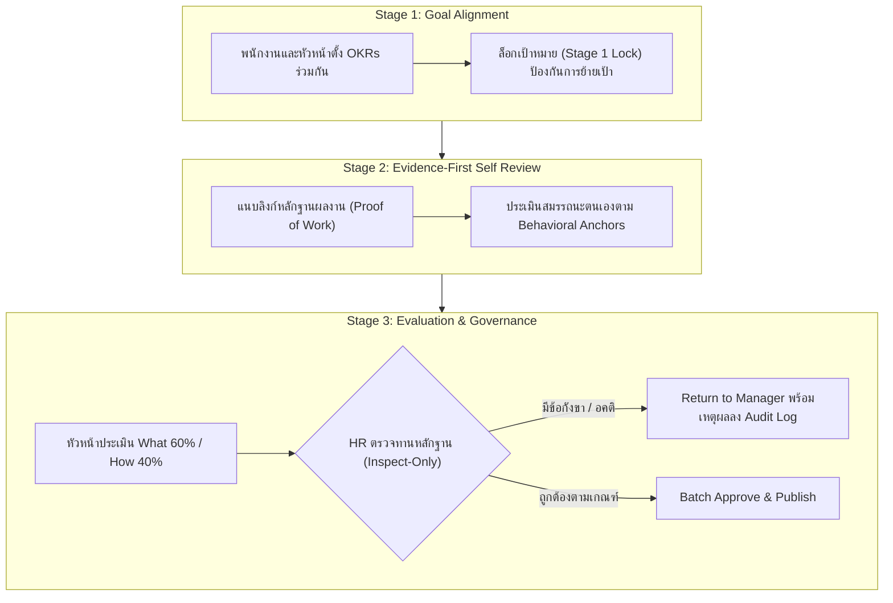
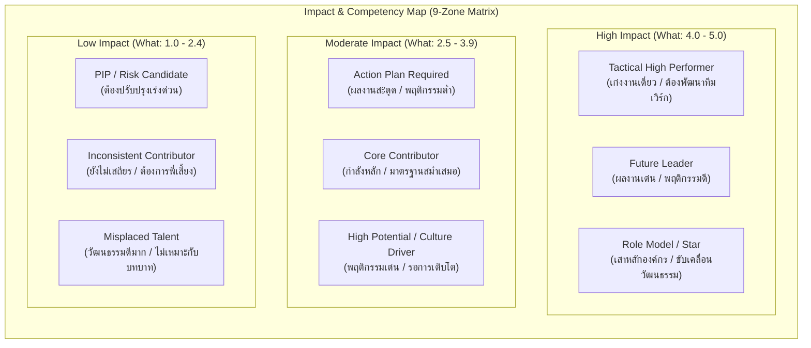
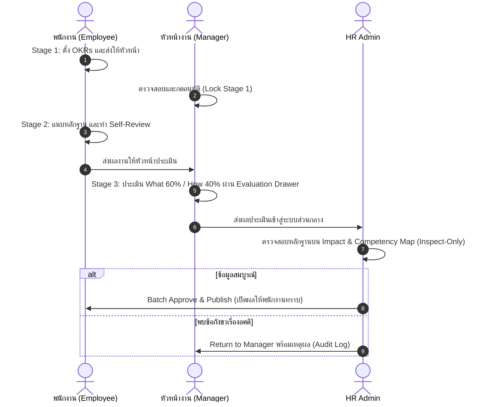
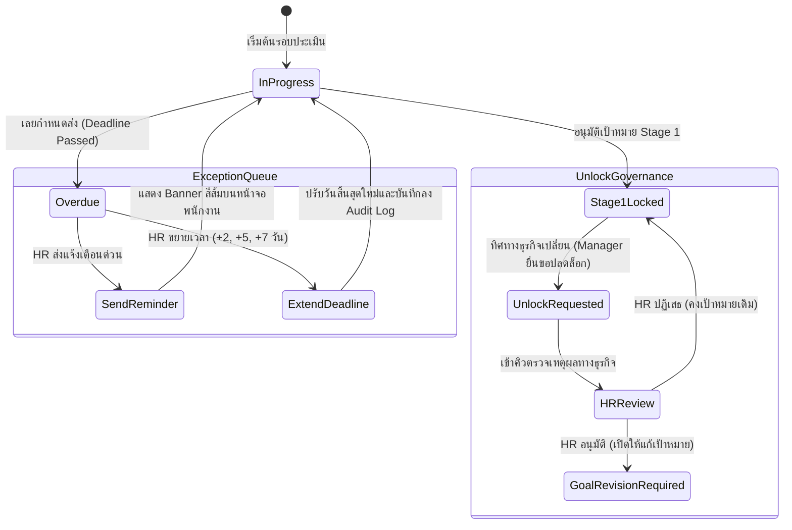
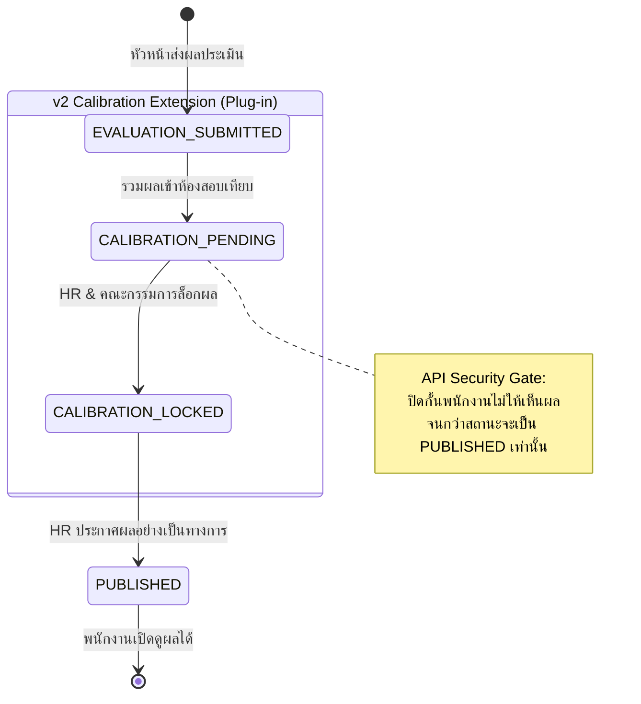
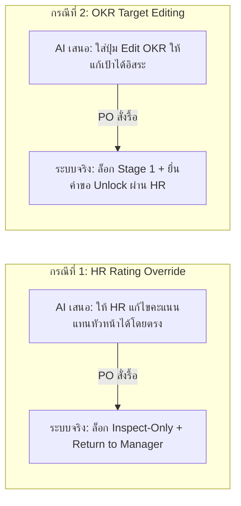
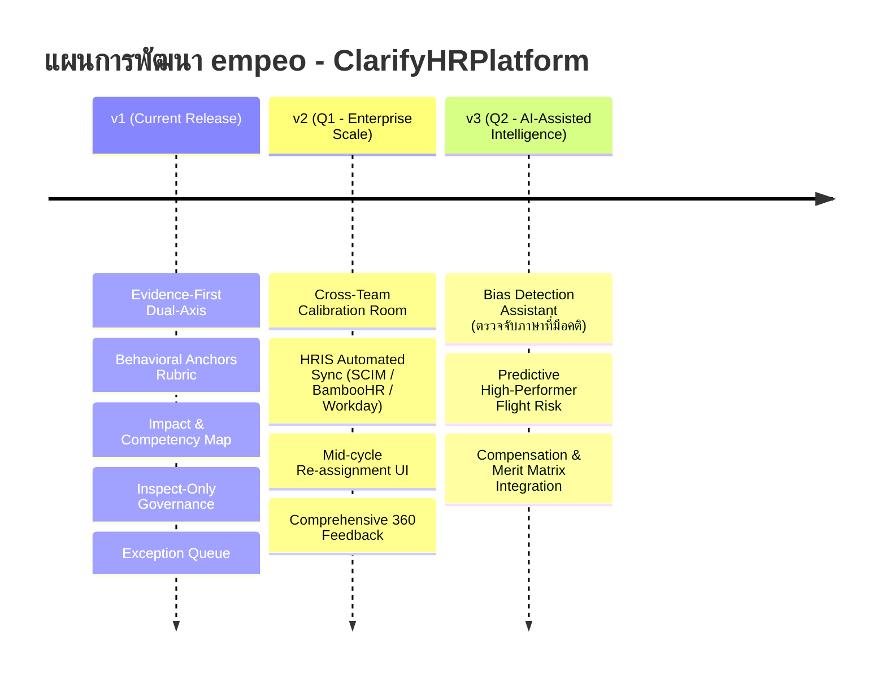

# empeo - ClarifyHRPlatform
## Executive Submission Document & Architectural Defense
**Role:** Product Owner (Performance Management Domain)  
**Platform:** empeo (HRM + HRD Platform)  
**Version:** 1.0 (Commercial-Ready Prototype)  
**Target Repository:** `https://github.com/Krist-KritnarinP/GOFIVE-OKRs.git`

---

## สารบัญ (Table of Contents)
1. [ภาพรวมเชิงกลยุทธ์ของผลิตภัณฑ์ (Executive Summary)](#1-ภาพรวมเชิงกลยุทธ์ของผลิตภัณฑ์-executive-summary)
2. [Part 1: การตอบโจทย์หลัก 4 ด้านและผังการทำงาน (Core Objectives & Infographics)](#2-part-1-การตอบโจทย์หลัก-4-ด้านและผังการทำงาน-core-objectives--infographics)
   - [2.1 Fairness: ความเป็นธรรมและมาตรฐานกลางขององค์กร](#21-fairness-ความเป็นธรรมและมาตรฐานกลางขององค์กร)
   - [2.2 Reflecting Real Performance: การสะท้อนผลงานจริงผ่าน Impact & Competency Map](#22-reflecting-real-performance-การสะท้อนผลงานจริงผ่าน-impact--competency-map)
   - [2.3 Multi-Role Collaboration: สถาปัตยกรรมบทบาทและการทำงานร่วมกัน](#23-multi-role-collaboration-สถาปัตยกรรมบทบาทและการทำงานร่วมกัน)
   - [2.4 Off-Plan Handling: กลไกการรับมือสถานการณ์นอกแผน](#24-off-plan-handling-กลไกการรับมือสถานการณ์นอกแผน)
3. [Part 2: การตอบคำถามเชิงกลยุทธ์และการบริหารผลิตภัณฑ์ (PO Strategic Q&A)](#3-part-2-การตอบคำถามเชิงกลยุทธ์และการบริหารผลิตภัณฑ์-po-strategic-qa)
   - [3.1 Question 1: Scope & Prioritization (ขอบเขต v1 และการตัด Scope)](#31-question-1-scope--prioritization-ขอบเขต-v1-และการตัด-scope)
   - [3.2 Question 2: The Requirement Changes (การรองรับ Cross-Team Calibration)](#32-question-2-the-requirement-changes-การรองรับ-cross-team-calibration)
   - [3.3 Question 3: Working with AI (การตัดสินใจทางวิชาชีพที่สั่งรื้อสิ่งที่ AI แนะนำ)](#33-question-3-working-with-ai-การตัดสินใจทางวิชาชีพที่สั่งรื้อสิ่งที่-ai-แนะนำ)
4. [แผนการพัฒนาสู่ระดับสากล (Product Roadmap: v1 → v2 → v3)](#4-แผนการพัฒนาสู่ระดับสากล-product-roadmap-v1--v2--v3)

---

## 1. ภาพรวมเชิงกลยุทธ์ของผลิตภัณฑ์ (Executive Summary)

**empeo - ClarifyHRPlatform** ถูกพัฒนาขึ้นเพื่อแก้ปัญหาเชิงโครงสร้างของระบบการประเมินผลงานแบบดั้งเดิม (Spreadsheet & Email-based Reviews) ซึ่งมักพบปัญหาเรื้อรัง 3 ประการ:
1. **Rater Inconsistency:** มาตรฐานคะแนนขึ้นอยู่กับอคติส่วนบุคคลของหัวหน้าแต่ละคน
2. **Floating Numerical Score:** การให้คะแนนตัวเลขตัวเดียว (เช่น 3.8/5) ที่ไม่สะท้อนความสามารถที่แท้จริง และไม่สามารถแยกแยะพนักงานกลุ่มที่มีผลงานเฉพาะทางได้
3. **Operational Drag:** กระบวนการล่าช้า พนักงานไม่เห็นเป้าหมายตนเอง และ HR ต้องตามรวบรวมไฟล์ Excel แบบ Manual

แพลตฟอร์มนี้เปลี่ยนผ่านระบบประเมินสู่ **หลักฐานเชิงประจักษ์ (Evidence-First Architecture)** ผสานการประเมินสองแกน **Dual-Axis Framework (What 60% / How 40%)** เพื่อสร้างความโปร่งใส ความเป็นธรรม และความพร้อมในการขยายผลระดับ Enterprise

---

## 2. Part 1: การตอบโจทย์หลัก 4 ด้านและผังการทำงาน (Core Objectives & Infographics)

---

### 2.1 Fairness: ความเป็นธรรมและมาตรฐานกลางขององค์กร

#### การเปรียบเทียบ: กระบวนการดั้งเดิม vs empeo - ClarifyHRPlatform

| มิติการประเมิน | วิธีการดั้งเดิม (Spreadsheet / Form กระดาษ) | empeo - ClarifyHRPlatform (v1) |
| :--- | :--- | :--- |
| **เกณฑ์การให้คะแนน** | ความรู้สึกส่วนตัวของหัวหน้า (Subjective Impression) | **Dual-Axis:** OKR Measurable 60% + Behavioral Anchors 40% |
| **การป้องกันอคติ** | ไม่มีกลไกป้องกัน (Strict vs Lenient Manager Bias) | **Behavioral Rubrics 1–5:** มีคำนิยามพฤติกรรมชัดเจนทุกระดับ |
| **ความน่าเชื่อถือของข้อมูล** | อ้างอิงจากความจำช่วงใกล้ประเมิน (Recency Bias) | **Evidence-First:** บังคับแนบหลักฐาน (Links/Metrics) กำกับทุกเป้าหมาย |
| **การกำกับดูแลของ HR** | HR แก้ไขคะแนนในไฟล์รวมได้เองโดยไม่มีใครรู้ | **Inspect-Only:** HR ตรวจดูได้เท่านั้น หากแก้ต้องส่งกลับผ่านระบบ |
| **การย้ายเป้าหมายหนี** | พนักงาน/หัวหน้าแอบลดตัวเลขเป้าหมายเมื่อทำไม่ถึง | **Stage 1 Lock:** ล็อกเป้าหมายทันที หากจะแก้ต้องยื่นขอปลดล็อก |

#### สิ่งที่ทำตามมาตรฐาน (Baseline) vs สิ่งที่ทำ Beyond มาตรฐาน
* **ตามมาตรฐานสากล:** 
  * การแยกวัดผลลัพธ์เชิงปริมาณ (Goals/OKRs) ออกจากพฤติกรรมเชิงคุณภาพ (Competencies)
  * การบังคับทำ Self-Review ก่อนที่หัวหน้าจะเริ่มประเมิน
* **Beyond มาตรฐานอุตสาหกรรม:**
  1. **Behavioral Anchored Rating Scales (BARS):** ไม่ใช้การให้ดาว 1–5 เปล่าๆ แต่ระบุคำบรรยายพฤติกรรมที่สังเกตได้ (Observable Behaviors) ครอบคลุมทั้ง 5 ระดับ ทำให้หัวหน้าที่เข้มงวดและหัวหน้าที่ใจดีต้องใช้ไม้บรรทัดเดียวกัน
  2. **Inspect-Only Governance Architecture:** ระบบตัดสิทธิ์ HR จากการแก้คะแนนแทนหัวหน้าโดยสิ้นเชิง เพื่อรักษาหลักการ Accountability ของผู้จัดการ และใช้กระบวนการ "Return to Manager" ที่มีการบันทึก Audit Trail โปร่งใส 100%

---

### 2.2 Reflecting Real Performance: การสะท้อนผลงานจริงผ่าน Impact & Competency Map

#### การจัดกลุ่มและแนวทางการบริหารจัดการบุคลากร (Talent Segmentation)
1. **กลุ่มดาวเด่น (High What, High How):** วางแผน Fast-Track และการสืบทอดตำแหน่ง (Succession Planning)
2. **กลุ่มผลงานสูงแต่พฤติกรรมขัดแย้ง (High What, Low How - Toxic High Performer):** ระบบตรวจจับได้ชัดเจน ไม่ปล่อยให้คะแนนผลงานมากลบปัญหาพฤติกรรม องค์กรต้องจัดแผน Behavioral Coaching ทันที
3. **กลุ่มพฤติกรรมดีเด่นแต่ผลงานสะดุด (Low What, High How - Misplaced Talent):** ระบบชี้ให้เห็นว่าบุคลากรมีค่านิยมตรงกับองค์กร แต่งานปัจจุบันอาจไม่ตรงกับทักษะ จึงควรพิจารณาปรับตำแหน่งงาน (Role Realignment) หรือ Upskilling
4. **กลุ่มต่ำกว่าเกณฑ์ทั้งสองด้าน (Low What, Low How):** เข้าสู่กระบวนการ Performance Improvement Plan (PIP) อย่างเป็นธรรมด้วยหลักฐานที่มีการบันทึกไว้ตลอดทั้งปี

#### สิทธิ์การมองเห็นข้อมูล (Visibility Matrix)
* **ผู้บริหารและ HR:** มองเห็นภาพรวมการกระจายตัวของทั้งองค์กร (Org Distribution Bar) และกรองดูรายแผนกตามสังกัด HRBP ได้
* **หัวหน้างาน:** มองเห็นเฉพาะผังการกระจายตัวของทีมตนเอง สามารถเปิด Drawer ดูคะแนนเปรียบเทียบ Self vs Manager ของลูกน้องได้
* **พนักงาน:** เห็นเฉพาะผลการประเมินและข้อคิดเห็นของตนเอง **ไม่มีสิทธิ์เห็นผังของเพื่อนร่วมงาน** เพื่อป้องกันปัญหาความขัดแย้งและรักษาบรรยากาศการทำงาน

---

### 2.3 Multi-Role Collaboration: สถาปัตยกรรมบทบาทและการทำงานร่วมกัน

#### บทบาทและชุดเครื่องมือเฉพาะในระบบ (Role Workspaces)
* **Employee Workspace:** จัดการเป้าหมาย OKRs, แนบลิงก์หลักฐาน, ทำ Self-Assessment ตามคำบรรยายพฤติกรรม, และดูผลการประเมินย้อนหลัง
* **Manager Workspace:** แดชบอร์ดติดตามสถานะลูกน้อง 40+ คน พร้อมชิปกรองสถานะ (All, OKRs Pending, Pending Review, Overdue, Completed), ระบบค้นหา, Evaluation Drawer เปรียบเทียบสองมุมมอง (Side-by-side), และฟังก์ชันขอปลดล็อกเป้าหมาย (Request OKR Unlock)
* **HR Admin Workspace:** แดชบอร์ด Impact & Competency Map, สลับมุมมองตามสังกัด HRBP Scope, คิวจัดการข้อยกเว้น (Exception Queue), Modal ตรวจสอบจำนวนก่อนกดยืนยันเผยแพร่ (Confirm Approve & Publish), และบันทึกกิจกรรมระบบ (Activity/Audit Log)
* **Super Admin Workspace:** ตรวจสอบความปลอดภัยระบบ และระบบสร้างรหัสเชิญพนักงานใหม่ (6-Digit CSPRNG Invite Codes พร้อมอายุ 72 ชั่วโมง)

#### บุคลากรจำลองในระบบ Demo (Pre-seeded Personas)
1. **EMP-001 (สมชาย):** ส่งผลงานครบ รอการประเมินจากหัวหน้า (Pending Evaluation)
2. **EMP-002 (กัญญา):** กำลังดำเนินการบันทึกความคืบหน้า (In Progress)
3. **EMP-003 (อาทิตย์):** เลยกำหนดส่งและมีคำขอปรับเป้าหมาย (Overdue & Goal Revision Request)
4. **EMP-004 (นันทนา):** ได้รับการประเมินและเผยแพร่ผลเรียบร้อยแล้ว (Published Star Performer)
5. **EMP-010 (ผู้จัดการกิตติ):** หัวหน้างานสำหรับทดสอบการประเมินลูกน้องหลายรูปแบบ
6. **EMP-1001 / 1002 (HR Admin):** ผู้ดูแลระบบสำหรับทดสอบการสลับสายงานกำกับดูแล (Engineering vs Sales)

---

### 2.4 Off-Plan Handling: กลไกการรับมือสถานการณ์นอกแผน

#### รายละเอียดเชิงตรรกะของการจัดการข้อยกเว้น (Exception Logic)
1. **การส่งงานเกินกำหนด (Overdue Handling):**
   * ระบบตรวจสอบ Timestamp เทียบกับวันสิ้นสุดรอบประเมิน หากพบรายการค้าง จะปรับสถานะเป็น `OVERDUE` และนำเข้า **Exception Queue** ของ HR โดยอัตโนมัติ
   * **Action 1 (Send Reminder):** HR กดส่งแจ้งเตือน ระบบจะสร้าง Banner แจ้งเตือนสีส้มแบบ Real-time บนหน้าจอของพนักงานและหัวหน้ารายนั้นทันที
   * **Action 2 (Extend Deadline):** HR สามารถขยายเวลาเป็นรายคน โดยเลือกวันขยายด่วน (+2, +5, +7 วัน) หรือระบุจำนวนวันเอง (1–30 วัน) โดยระบบบังคับเลือกหมวดเหตุผล (`Medical / Emergency`, `Technical Block`, `Organizational Change`) และบันทึกประวัติลง Audit Log ทุกครั้ง
2. **การเปลี่ยนทิศทางธุรกิจกลางปี (Mid-Cycle Goal Pivot):**
   * ระบบล็อกเป้าหมาย OKR อัตโนมัติหลังจบ Stage 1 เพื่อป้องกันการลดเป้าหมายตามอำเภอใจ
   * หากมีเหตุผลทางธุรกิจจริง หัวหน้าต้องกดปุ่ม **"Request OKR Unlock"** ระบุเหตุผล คำขอจะวิ่งเข้าสู่ Exception Queue ให้ HR พิจารณา เมื่อ HR อนุมัติ สถานะจะเปลี่ยนเป็น `GOAL_REVISION_REQUIRED` จึงจะเปิดให้แก้ไขเป้าหมายได้
3. **การประเมินที่มีอคติหรือไม่เป็นธรรม (Unfair Evaluation):**
   * HR มีปุ่ม **"Return to Manager"** บังคับระบุข้อสังเกต ระบบจะส่งใบประเมินกลับไปให้หัวหน้าทบทวนใหม่ และเปลี่ยนสถานะกลับเป็น `IN_REVIEW`

#### กรณีที่ไม่ได้เตรียมหน้าจอรับมือไว้ (ต้องแก้ไขผ่าน Database/Dev)
* **การโอนย้ายพนักงานหรือหัวหน้าลาออกกะทันหันระหว่างรอบประเมิน (Mid-cycle Reorganization):** ใน v1 ยังไม่มีหน้าจอ Re-assign Reviewer กลางคัน หากหัวหน้าลาออกกะทันหัน ต้องให้ผู้ดูแลระบบ (Dev/DBA) เข้าไปอัปเดตฟิลด์ `reportingManagerId` ในตารางผู้ใช้งานเพื่อเปลี่ยนตัวผู้ประเมิน
* **การยกเลิกการประกาศผลย้อนหลัง (Publish Rollback):** เพื่อความปลอดภัยของข้อมูลและป้องกันความสับสนของพนักงาน ผลการประเมินที่ถูก `PUBLISHED` แล้วจะไม่สามารถกดยกเลิกผ่านหน้าจอได้ หากเกิดข้อผิดพลาดร้ายแรงต้องให้ทีม Dev เข้าไปปรับสถานะในฐานข้อมูลโดยตรง

---

## 3. Part 2: การตอบคำถามเชิงกลยุทธ์และการบริหารผลิตภัณฑ์ (PO Strategic Q&A)

---

### 3.1 Question 1: Scope & Prioritization (ขอบเขต v1 และการตัด Scope)

#### สิ่งที่รวมอยู่ใน v1:
* ระบบการประเมินผลงานแบบครบวงจรตั้งแต่ต้นจนจบ: การตั้งและล็อกเป้าหมาย OKR, การแนบหลักฐาน, การประเมินสมรรถนะตนเองตามพฤติกรรม (Behavioral Anchors 1–5), หน้าจอเฉพาะสำหรับ 3 บทบาท (Employee, Manager, HR Admin), แผนผังผลลัพธ์และสมรรถนะ (Impact & Competency Map), คิวจัดการข้อยกเว้น (Exception Queue) และ Audit Trail ครบถ้วน

#### สิ่งที่จงใจตัดออก (Deliberately Left Out) และเหตุผลเชิงกลยุทธ์:
1. **Cross-Team Calibration Room:** เพื่อให้ v1 มุ่งเน้นการแก้ปัญหาที่รากฐานก่อน คือการสร้างความเข้าใจระหว่างหัวหน้ากับลูกน้องผ่านหลักฐานจริง และไม่สร้างความซับซ้อนเกินไปแก่องค์กรที่เพิ่งเปลี่ยนมาจากระบบ Spreadsheet
2. **360-Degree Peer Feedback:** ตัดออกเนื่องจากการประเมินจากเพื่อนร่วมงานในองค์กรที่วัฒนธรรมยังไม่พร้อม มักกลายเป็นการให้คะแนนตามความสนิทสนม (Popularity Contest) มากกว่าการสะท้อนผลงานจริง
3. **การคำนวณเงินเดือนและโบนัสอัตโนมัติ (Compensation Linkage):** ตัดการเชื่อมโยงผลประเมินกับผลตอบแทนออก เพื่อลดแรงกดดันและมุ่งเน้นการพัฒนาศักยภาพ (Development-focused) ก่อนการตัดเกรดจ่ายเงิน

#### การประเมินความเหมาะสมในการส่งมอบลูกค้าสัปดาห์หน้า:
**เป็นสัดส่วนที่เหมาะสมที่สุด (The Right Slice)** สำหรับการเริ่มต้นใช้งานจริง เพราะแก้ปัญหาคอขวดหลักของลูกค้าได้ทันทีโดยไม่ก่อให้เกิดภาระในการเรียนรู้ (Zero-Learning-Curve UX พนักงานเริ่มใช้งานได้ภายใน 5 นาที) สิ่งที่ต้องดำเนินการก่อนเปิดให้ลูกค้าจริงใช้งานมีเพียง:
1. ปิดโหมดสลับสิทธิ์จำลอง (Turn off Demo Role Switcher)
2. เชื่อมต่อ API ดึงข้อมูลโครงสร้างพนักงานจากระบบ HRIS ของลูกค้า

---

### 3.2 Question 2: The Requirement Changes (การรองรับ Cross-Team Calibration)

#### การรองรับของสถาปัตยกรรมปัจจุบัน (Design Absorption):
ระบบ v1 ถูกออกแบบสถาปัตยกรรมแบบ **State-Driven Workflow** จึงสามารถดูดซับ Requirement นี้ได้ทันทีโดยไม่ต้องรื้อฐานข้อมูลใหม่:
1. **State Machine Insertion:** เพียงแทรกสถานะย่อย 2 สถานะ คือ `CALIBRATION_PENDING` และ `CALIBRATION_LOCKED` ก่อนเข้าสู่ `PUBLISHED`
2. **Server-Side Security Gate:** API ของระบบปัจจุบันมีกลไกตรวจสอบอยู่แล้วว่า พนักงานจะเข้าถึงข้อมูลผลประเมินได้ก็ต่อเมื่อ `status === 'PUBLISHED'` เท่านั้น ดังนั้น ในช่วงที่ผลยังอยู่ในขั้นตอน Calibration ข้อมูลจะไม่รั่วไหลไปสู่พนักงานอย่างแน่นอน

#### สิ่งที่ต้องพัฒนาเพิ่มเติม (What to Adjust):
* **Calibration Room Interface:** หน้าจอเฉพาะสำหรับ HR และผู้บริหารระดับสูงเพื่อสอบเทียบคะแนน:
  * แสดงข้อมูลเปรียบเทียบพนักงานที่อยู่ใน **Job Level เดียวกันข้ามแผนก** (เช่น เปรียบเทียบ Senior Engineer ของทุกทีมพร้อมกัน)
  * กราฟแสดงสัดส่วนการกระจายตัวของคะแนนก่อนเทียบกับหลังสอบเทียบ
  * บังคับกรอก **Calibration Justification** ทุกครั้งที่มีการขยับคะแนน และบันทึกประวัติก่อน-หลังลงใน Audit Log

#### ตัวชี้วัดความสำเร็จของฟีเจอร์ (Success Metrics):
1. **Cross-Department Variance Reduction:** ค่าความแปรปรวนของคะแนนเฉลี่ยระหว่างแผนกใน Job Level เดียวกันลดลงอย่างมีนัยสำคัญทางสถิติ (พิสูจน์ว่ามาตรฐานของหัวหน้าแต่ละคนถูกปรับให้อยู่บนเกณฑ์เดียวกัน)
2. **Target Distribution Alignment:** สัดส่วนการกระจายตัวของผลงานทั้งองค์กรเป็นไปตามเป้าหมายโควตาที่กำหนด (เช่น สัดส่วน 20-70-10)
3. **Cycle Time to Lock:** ระยะเวลาที่ใช้ในกระบวนการ Calibration จนกระทั่งล็อกผลเสร็จสิ้นต้องไม่เกิน 5 วันทำการ

---

### 3.3 Question 3: Working with AI (การตัดสินใจทางวิชาชีพที่สั่งรื้อสิ่งที่ AI แนะนำ)

ในการพัฒนาโปรเจกต์นี้ร่วมกับ AI มี 2 เหตุการณ์สำคัญที่ผมในฐานะ Product Owner ไม่เห็นด้วยกับสิ่งที่ AI นำเสนอ และสั่งรื้อกระบวนการทำใหม่เพื่อรักษามาตรฐานการกำกับดูแลขององค์กร:

#### 1. กรณีสิทธิ์การแก้ไขคะแนนของ HR สู่โมเดล "Inspect-Only Governance"
* **สิ่งที่ AI เสนอ:** ตอนสร้างหน้า HR Dashboard ทาง AI ได้เขียนโค้ดให้ HR สามารถคลิกที่ชื่อพนักงานเพื่อเปิด `EvaluationDrawer` แล้วสามารถแก้ไขตัวเลขคะแนนประเมินแทนหัวหน้างานได้ทันที พร้อมเปิดสิทธิ์ `HR_ADMIN` ใน API `PUT /manager-review` เพราะ AI มองเรื่องความสะดวกในการใช้งาน
* **เหตุผลที่สั่งรื้อ:** ในองค์กรจริง HR ไม่ได้ทำงานใกล้ชิดกับพนักงานทุกวัน การให้ HR แอบแก้คะแนนแทนทำลายความรับผิดชอบของหัวหน้า (Manager Accountability) และทำลายความโปร่งใสขององค์กร
* **สิ่งที่สั่งแก้และผลลัพธ์:** สั่งล็อกหน้าจอ HR ให้เป็น **Inspect-Only (ตรวจทานหลักฐานเท่านั้น)** ล็อกสิทธิ์ API ฝั่ง Backend คืนค่า `403 Forbidden` หาก HR พยายามส่งคะแนน และสร้างฟังก์ชัน **"Return to Manager"** พร้อมบังคับระบุเหตุผลเพื่อส่งกลับไปให้หัวหน้าแก้ไขผ่านระบบอย่างเป็นทางการ

#### 2. กรณีการปรับแก้เป้าหมาย OKR: สมดุลระหว่าง Business Agility กับการย้ายเป้าหนี (Goalpost Moving)
* **สิ่งที่ AI เสนอ:** AI ใส่ปุ่ม "Edit OKR" ค้างไว้ในหน้าจอ เพื่อให้หัวหน้าและพนักงานสามารถกดแก้ตัวเลขเป้าหมายได้ตลอดเวลา
* **มุมมองจากประสบการณ์จริง:** 
  * การปล่อยให้แก้เป้าหมายได้อย่างอิสระจะเปิดช่องให้เกิด **Goalpost Moving** (การแอบปรับลดเป้าหมายช่วงใกล้สิ้นปีเพื่อให้ตนเองได้คะแนนประเมินสูง)
  * แต่ในทางกลับกัน การล็อกเป้าหมายตายตัวจนแก้ไขไม่ได้เลยก็ไม่สอดคล้องกับสภาพธุรกิจจริงในปัจจุบันที่ทิศทางขององค์กร (Company Direction) อาจมีการปรับเปลี่ยนกะทันหันกลางปี
* **สิ่งที่สั่งแก้และผลลัพธ์:** สร้างกระบวนการ **Formal Unlock Request Workflow** โดยระบบจะล็อกเป้าหมายเป็นค่าเริ่มต้นหลังจบ Stage 1 หากทิศทางธุรกิจเปลี่ยน หัวหน้าต้องกดปุ่มขอปลดล็อกพร้อมระบุเหตุผลทางธุรกิจเข้าสู่ Exception Queue ของ HR เมื่อ HR อนุมัติ จึงจะเปิดให้แก้ไขเป้าหมายได้

---

## 4. แผนการพัฒนาสู่ระดับสากล (Product Roadmap: v1 → v2 → v3)

---
**เอกสารฉบับนี้จัดทำขึ้นสำหรับการสอบตำแหน่ง Product Owner ของ empeo (Gofive)**  
*รหัสอ้างอิงชุดทดสอบ: PO-EXAM-2026-FINAL*
