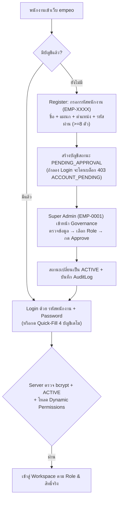
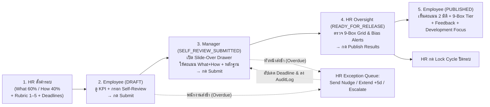

# empeo — Performance Management Prototype: Master Product & Presentation Plan

**Project:** Gofive Product Owner (PO) Assignment — *empeo Performance Management*  
**Workspace:** `GOFIVE TEST` (Pure JS Full-Stack: `frontend/` + `backend/` + `docs/`)  
**Design System:** *Nordic Slate & Electric Cobalt* (Stitch Project ID: `3796363739561536319`)  
**Central Challenge:**
> *"How do we make annual performance reviews **fair** across an entire organization, and genuinely surface who the **high performers** and **low performers** are?"*

---

## 1. Master Checklist — หัวข้อหลักที่ได้มา & แยกว่ามีอะไรต้องทำบ้าง

### A. สิ่งที่ทำเสร็จแล้ว (Done ✅)
- [x] **วางกติกา & โครงสร้างกลาง:** แยก `frontend/`, `backend/`, `docs/` + กฎ 4 ไฟล์ (`docs/rules/00`–`03`) + ห้องกลาง `docs/agent-hub/` + แม่แบบสีแดงบน Desktop (`Doc CODE Agent hub`) + ผูก GitHub `https://github.com/Krist-KritnarinP/GOFIVE-OKRs.git`
- [x] **กำหนด Design System & Guardrails:** ล็อกชุดสี *Nordic Slate & Electric Cobalt*, WCAG 2.1 AA, Zero Glassmorphism, `0ms` Instant UI, Zero Heavy Libraries (ถอด `motion` + `recharts`), ชื่อระบบตัวหนังสือ `empeo` ล้วนไม่มีโลโก้
- [x] **ร่าง UI ครบ 6 หน้าจอบน Google Stitch:** Login, Register, Super Admin, HR Admin 9-Box, Manager + Slide-Over Drawer, Employee OKRs & Results
- [x] **พัฒนา Backend API + Security/RBAC (Pure ESM `.js`):** Express 5, Prisma 6.19.3 (Supabase Dual-URL), Zod Validation, JWT Auth, Login รหัสพนักงาน, 16-User 1-Office Demo, Job Leveling (`L1–L4`), OKR Co-Edit Weight/Multiplier, 3-Stage Due Dates, HRBP Advisor Comment, แนวทาง A (`HR Approve & Publish`), และ Strict 4-Role Activity Log (`GET /api/v1/activity-logs`)
- [x] **พัฒนา Frontend Working Prototype (Pure `.jsx`):** Clean Login + Gold Bypass Demo (`คลิกเพื่อจำลองdemo`) → 2-Level Role/Person Picker + ครบทั้ง 4 Role + 9-Box Grid + แถบ 3-Stage Status พร้อมวันที่/Countdown/Early/Overdue + Bilingual **EN ↔ ไทย** + Browser QA (Gate 3)

### B. สิ่งที่กำลังทำต่อเพื่อปิดงานส่งจริง (Remaining To-Do ⬜)
- [ ] **Full-Site Skill Audit Fixes (Phases B–D):** ปิดช่องโหว่ State Guard ฝั่ง Backend, Native `<dialog>`, แก้ Timezone +7d / Dynamic Overdue, แปลง Enum Badge เป็นภาษาคน EN/TH 100%, Segmented Status Track & Accessibility
- [ ] **Deploy เป็นลิงก์ออนไลน์ที่กดเล่นได้จริง:** Deploy หน้าบ้านจาก `https://github.com/Krist-KritnarinP/GOFIVE-OKRs.git` (Vercel/Netlify/Cloudflare Pages)
- [ ] **สรุปคำตอบ Part 2 (3 ข้อ) & ซ้อมพรีเซนต์ 5 นาที:** ใช้เคสจริงที่บันทึกใน `docs/note.md` และซ้อมคลิกเดโมตามสคริปต์ในหัวข้อที่ 9

---

## 2. Pain Points → การแก้ปัญหาเชิงตรรกะ (Root Cause → Logical Design)

| # | Pain Point จริงขององค์กร (Excel / Email) | รากเหง้าของปัญหา (Root Cause) | ตรรกะการแก้ปัญหาที่เราออกแบบ (Logical Mechanism) | ผลลัพธ์ที่วัดได้ (Outcome) |
| :-: | :--- | :--- | :--- | :--- |
| **1** | **หัวหน้าแต่ละคนให้คะแนนคนละมาตรฐาน (Bias)** — ทีมหนึ่งใจดีแจก 5 หมด อีกทีมกดคะแนน | ปุ่ม 1–5 ไม่มีคำนิยามร่วมกัน + ให้คะแนนสุดโต่งได้โดยไม่ต้องอธิบาย + ไม่มีตัวเทียบข้ามทีม | 1) แสดง **Behavioral Anchor Rubric** มาตรฐานเดียวกันข้างปุ่มคะแนนทุกครั้ง<br>2) บังคับ **Evidence Guardrail** (`1`, `2`, `5` ต้องเขียนหลักฐาน ≥ 20 ตัวอักษร ทั้ง Client & Server)<br>3) รันสูตร **Manager Bias Alert** เทียบ `teamAvg` กับ `orgAvg` | อคติถูกดักตั้งแต่ตอนกรอก และ HR เห็นทีมที่คะแนนเพี้ยนทันที |
| **2** | **คะแนนลอยๆ ไม่เห็นชัดว่าใคร High / Low Performer** | ยุบทุกอย่างเป็นคะแนนเดียว (Single Score) จนแยกไม่ออกว่าเก่งงานแต่พฤติกรรมแย่ หรือพฤติกรรมดีแต่ยอดไม่ถึง | แยกประเมิน **2 แกน (Dual-Axis)**:<br>- **What (60%):** ผลสำเร็จ KPI/Goal (ผสาน Progress % จริง + คะแนนหัวหน้า)<br>- **How (40%):** สมรรถนะหลัก (1–5)<br>แล้วพล็อตลง **9-Box Performance Grid** | แยก *Star / High Performer*, *High Impact*, *Core*, และ *Needs Action* ออกอย่างมีบริบท |
| **3** | **พนักงานไม่เห็นเป้าหมายของตัวเอง & กลัวไม่โปร่งใส** | KPI อยู่ในไฟล์แยก พนักงานไม่รู้เกณฑ์ล่วงหน้า และไม่รู้สถานะว่ารีวิวไปถึงไหนแล้ว | หน้า **Employee Workspace** แสดง KPI + น้ำหนัก % + Progress Bar + 4-Step Lifecycle Stepper + ล็อกผลไว้จน HR ประกาศแล้วจึงแสดง Breakdown + Feedback + แผนพัฒนา | พนักงานรู้เกณฑ์ตั้งแต่วันแรก และมั่นใจในความยุติธรรม |
| **4** | **หัวหน้า/พนักงานส่งช้า นอกแผน (Off-Plan)** | ไม่มีระบบติดตาม Deadline ไม่มี Escalation และ HR ไม่กล้าปิดรอบ | ระบบคำนวณ **Overdue อัตโนมัติ** แยกตาม Stage + คิว **Exception Queue** ให้ HR กด **Nudge**, **Extend +5 วัน**, **Escalate ข้ามขั้น**, หรือเปิด **Grace Period / Lock Cycle** พร้อม **Audit Log** | HR ควบคุมเวลาได้จริงแม้เกิดเหตุไม่คาดฝัน |
| **5** | **HR รวมข้อมูลไม่ไหว & เสี่ยงข้อมูลรั่วก่อนประกาศผล** | รวมไฟล์ Excel ด้วยมือ เสี่ยงไฟล์หลุด พนักงานแอบเห็นคะแนนก่อนเวลา | ศูนย์กลางเดียว + **Server-side RBAC & Publish Gate** (`sanitizeReviewForRole` ตัดคะแนนหัวหน้าทิ้งจาก API Response 100% จนกว่า `status === PUBLISHED`) | รวมผลอัตโนมัติแบบเรียลไทม์ และปิดช่องโหว่ข้อมูลรั่ว |

---

## 3. โครงสร้างหลักของเว็บ (Web & System Architecture)

### A. Sitemap & Screen Hierarchy
```text
/ (Auth Gate)
├── Login Screen (รหัสพนักงาน EMP-XXXX + Password + 4 Quick-Fill Demo Accounts)
├── Register Screen (สมัครด้วยรหัสพนักงาน → สถานะ PENDING_APPROVAL)
└── Authenticated App Shell (Static Top Bar: empeo | รหัสพนักงาน | Role Switcher | EN/ไทย | Sign Out)
    ├── [SUPER_ADMIN] Access Control & Role Governance Dashboard
    │   ├── 4 Governance KPIs
    │   ├── Pending Registration Approval Queue (Approve / Assign Role)
    │   ├── Dynamic Role Permission Matrix (8 Permissions × 4 Roles)
    │   └── Organization User Directory (Role / Suspend / Activate)
    ├── [HR_ADMIN] Organization Fairness & Performance Console
    │   ├── Cycle Controls (Grace Period Toggle | Lock Cycle Toggle | Publish Ready Results CTA)
    │   ├── 4 Org KPIs (Completion %, Overdue, Org Avg, Bias Alerts)
    │   ├── 9-Box Performance Grid (Interactive 3×3 Matrix — click chip → Inspect Drawer)
    │   ├── Org Score Distribution Bar + Manager Bias Alerts
    │   ├── Off-Plan & Overdue Exception Queue (Nudge / Extend +5d / Escalate) + Audit Log
    │   └── Organization Review Roster (6 Columns)
    ├── [MANAGER] Team Performance Evaluations Workspace
    │   ├── Manager Persona Switcher (Engineering / Sales Bias / Product)
    │   ├── Team KPIs + Team vs. Org Fairness Guardrail Banner
    │   ├── Direct Reports Table (Status / Overdue Badge / Evaluate CTA)
    │   └── Slide-Over Evaluation Workbench Drawer (Self-Review + Goals + Rubric + Evidence Guardrail)
    └── [EMPLOYEE] My Goals & Annual Performance Review
        ├── Employee State Previewer (Published Star / Locked Pending HR / Overdue Draft)
        ├── 4-Step Lifecycle Stepper
        ├── My Assigned Goals & Self-Assessment Form
        └── Result Panel (Locked State before Publish | Published Dual-Axis Outcome & Development Focus)
```

### B. Technical & Security Guardrails
- **Code Separation:** `frontend/` (Pure `.jsx`, Port `5173`) · `backend/` (Pure ESM `.js`, Port `5001`) · `docs/` (Guidelines, Handover, Notes, Agent Hub)
- **Database Schema (5 ตารางหลัก + Hybrid Normalized):** `User` (`employeeCode @unique`, `accountStatus`), `RolePermission`, `ReviewCycle` (`isGracePeriodActive`, `isLocked`), `Goal`, `Review` (`whatPct`, `whatScore`, `howScore`, `overallScore`, `nineBoxCell`, Zod-validated JSON payloads), `AuditLog`
- **Visual Craft & Speed:** *Nordic Slate & Electric Cobalt*, Zero Glassmorphism (opaque surfaces only), WCAG 2.1 AA (`>= 4.5:1`), `0ms` instant state updates, Zero Heavy Libraries (no Framer Motion / no Recharts).

---

## 4. Role & Responsibility (4 บทบาท + Dynamic Permission Matrix)

| Role | รหัสเดโม | หน้าที่รับผิดชอบหลัก | สิทธิ์เริ่มต้น (Super Admin ปรับเปิด/ปิดได้เรียลไทม์) |
| :--- | :---: | :--- | :--- |
| **Super Admin** | `EMP-0001` | คุมความปลอดภัยองค์กร อนุมัติบัญชีพนักงานใหม่ กำหนดตำแหน่ง และเปิด/ปิดสิทธิ์ของแต่ละ Role | `rbac:manage` *(ล็อกห้ามปิด)* + ทุกสิทธิ์ในระบบ |
| **HR Admin** | `EMP-1001` | ตั้งค่ารอบประเมิน ตรวจ 9-Box & Bias Alerts จัดการเคสส่งช้า คุม Grace Period / Lock Cycle และกด Publish ผล | `cycle:configure`, `analytics:view_org`, `exception:manage`, `review:publish`, `team:evaluate`, `self:submit`, `audit:view` |
| **Manager** | `EMP-2001`..`2003` | ประเมินลูกทีมตรงตามสายบังคับบัญชา เทียบ Self-Review แนบหลักฐานตาม Rubric และคุมคะแนนทีมไม่ให้เบี่ยงเบน | `team:evaluate`, `self:submit` *(เห็นเฉพาะลูกทีมตัวเอง ถูกบล็อกฝั่ง Server หากแอบดูทีมอื่น)* |
| **Employee** | `EMP-3001`..`3008` | ติดตาม KPI ของตัวเอง ส่ง Self-Review พร้อมหลักฐาน และดูผลประเมิน + แผนพัฒนาหลัง HR ประกาศผล | `self:submit` *(ถูกตัดคะแนนหัวหน้าออกจาก API 100% ก่อน `PUBLISHED`)* |

---

## 5. User Workflow (แบบละเอียด ครบทุกเส้นทาง)

### Flow A: Onboarding, Registration & Employee-Code Login


### Flow B: Annual Review Main Flow + Off-Plan Exception Flow


### Flow C: Future Calibration Extension Point (รองรับโจทย์ Part 2 ข้อ 2)
```text
v1 ปัจจุบัน:  DRAFT → SELF_REVIEW_SUBMITTED → READY_FOR_RELEASE ──────────────────────────────▶ PUBLISHED
v2 เพิ่ม Calibration:                          READY_FOR_RELEASE → CALIBRATION_PENDING → CALIBRATION_LOCKED → PUBLISHED
```
*จุดเด่นทางวิศวกรรม:* เพราะระบบล็อกการเห็นผลของพนักงานไว้ที่ `status === 'PUBLISHED'` เพียงเงื่อนไขเดียวฝั่ง Server การแทรกขั้นตอน Calibration ข้ามทีมจึงไม่กระทบโครงสร้าง Auth, ฟอร์มประเมิน หรือหน้า Employee เลย

---

## 6. Feature พื้นฐานของเว็บ (Core Foundation Features)
1. **Employee-Code Authentication & Account Approval:** ล็อกอินด้วยรหัสพนักงาน + รหัสผ่าน (bcrypt + JWT), สมัครใหม่ต้องรออนุมัติ ป้องกันคนนอกเข้าถึงข้อมูลองค์กร
2. **Dynamic RBAC Governance (Super Admin):** ปรับสิทธิ์ 8 Permission Keys ของแต่ละ Role ได้เรียลไทม์ พร้อมบังคับตรวจทั้ง UI และ Backend Middleware (`requirePermission`)
3. **Bilingual EN / ไทย (ธรรมชาติ):** ภาษาอังกฤษเป็นหลัก สลับเป็นภาษาไทยเชิงธุรกิจ HR ที่อ่านเป็นธรรมชาติได้ในคลิกเดียว
4. **Full-Screen Edge-to-Edge & Universal Responsive:** ใช้งานเต็มจอไม่มีขอบว่าง รองรับ Desktop, iPad/Tablet และ Smartphone พร้อมฟอนต์อ่านง่ายทุกเพศทุกวัย (WCAG 2.1 AA)
5. **Security & Audit Baseline:** Helmet Security Headers, CORS Whitelist, Rate Limiting, Zod Validation ทุก Endpoint, และ Governance Audit Trail ทุก Action สำคัญ
6. **0ms Instant Demo Experience:** สลับดูได้ทุก Role และหลาย Persona (หัวหน้ามี Bias / หัวหน้าส่งช้า / พนักงานผลออกแล้ว / พนักงานรอประกาศ / พนักงานส่งช้า) ได้ทันทีไม่ต้องรอนาน

---

## 7. Key Features ที่ใช้แก้ Pain Point (เจาะลึกการออกแบบตรรกะ)

### Key Feature 1: Shared Behavioral Anchor Rubric (มาตรฐานกลาง 1–5)
- **ตรรกะที่ออกแบบ:** แทนที่จะแสดงแค่ตัวเลข 1–5 ให้หัวหน้าตีความเอง ทุกครั้งที่หัวหน้าคลิกเลือกคะแนน (1–5) ใน Slide-Over Drawer ระบบจะแสดง **คำนิยามพฤติกรรมมาตรฐานเดียวกันทั้งองค์กร** ทันทีใต้ปุ่ม (เช่น `3 = ส่งมอบงานตามเป้าหมายสม่ำเสมอ`, `5 = สร้างผลลัพธ์ระดับเปลี่ยนแปลงองค์กร`)
- **แก้ Pain Point:** ลดความต่างในการตีความคำว่า "ดีมาก" ระหว่างแผนก Engineering กับ Sales

### Key Feature 2: Evidence-Required Guardrail (กฎบังคับหลักฐานสำหรับคะแนนสุดโต่ง)
- **ตรรกะที่ออกแบบ:**
  ```text
  IF (submit === true) AND (score === 1 OR score === 2 OR score === 5)
     AND (evidence.trim().length < 20)
  THEN REJECT (Client inline error + Server HTTP 400 VALIDATION_ERROR)
  ```
- **แก้ Pain Point:**
  - ป้องกันหัวหน้าใจดีกด 5 รัวๆ โดยไม่มีผลงานรองรับ (Leniency Bias)
  - ป้องกันการให้คะแนนต่ำ (1–2) อย่างไม่เป็นธรรมโดยไม่มีข้อเท็จจริงให้พนักงานนำไปปรับปรุง

### Key Feature 3: Dual-Axis Scoring Engine → 9-Box Performance Grid
- **ตรรกะการคำนวณฝั่ง Server (`scoringService.js`):**
  1. **แกน X — Goal Achievement (`whatPct`):** ผสานความคืบหน้า KPI จริง (`progressPct` 60%) กับคะแนนประเมินเป้าหมายจากหัวหน้า (`(score/5)*100` 40%) ถ่วงน้ำหนักตาม Weight ของแต่ละ KPI → แบ่งเป็น 3 ช่วง: **Low (`< 65%`)**, **Mid (`65–89%`)**, **High (`>= 90%`)**
  2. **แกน Y — Core Competencies (`howScore`):** ค่าเฉลี่ย 3 สมรรถนะหลัก (Ownership, Collaboration, Problem Solving) → แบ่งเป็น 3 ช่วง: **Low (`< 2.6`)**, **Mid (`2.6–3.9`)**, **High (`>= 4.0`)**
  3. **คะแนนรวม (`overallScore`):** `(whatScore × 60%) + (howScore × 40%)`
  4. **9-Box Mapping:** จับคู่ `(X Band, Y Band)` ลง 9 ช่อง เช่น `(High, High) → Star / High Performer` และ `(Low, Low) → Needs Action / Low Performer`
- **แก้ Pain Point:** เห็นความจริงทันที เช่น พนักงานทีม Sales ที่หัวหน้าให้ 5/5 แต่ KPI จริงได้แค่ 72% จะไม่หลุดไปอยู่ช่อง Star มั่วๆ แต่ตกอยู่ช่อง *Strong Contributor* ให้ HR สังเกตเห็นความขัดแย้งทันที!

### Key Feature 4: Automated Manager Bias & Distribution Guardrail
- **ตรรกะการตรวจจับ:**
  ```text
  teamAvg = average(team overallScores)
  delta   = teamAvg - orgAverageScore
  topRatio = count(score >= 4.6) / teamSize

  IF (teamSize >= 2) AND (delta >= +0.65 OR topRatio >= 0.75) → FLAG: LENIENCY_BIAS
  IF (teamSize >= 2) AND (delta <= -0.65 OR lowRatio >= 0.75) → FLAG: SEVERITY_BIAS
  ```
- **แก้ Pain Point:** แสดงทั้งบน **HR Dashboard** (เตือน HR ให้เข้าไปตรวจทีมของ Somchai Sales) และบน **Manager Workspace** (เตือนหัวหน้าเองก่อนกดส่ง)

### Key Feature 5: Strict Publish Gate & Server-Side Sanitization
- **ตรรกะความปลอดภัย:** ฟังก์ชัน `sanitizeReviewForRole(review, user)` บน Backend บังคับว่าหาก `user.role === 'EMPLOYEE'` และ `review.status !== 'PUBLISHED'` ระบบจะลบ `managerPayload`, `whatScore`, `howScore`, `overallScore`, `nineBoxCell` เป็น `null` ก่อนส่ง JSON ออกไปเสมอ — แม้พนักงานจะเปิด DevTools ยิง API ตรงก็ไม่สามารถแอบดูคะแนนได้

### Key Feature 6: Off-Plan Exception Engine (`Nudge / Extend / Escalate / Lock`)
- **ตรรกะ:** เปรียบเทียบวันปัจจุบันกับ `extendedDeadline ?? stageDeadline` หากเลยกำหนด ระบบระบุ `missingActor` (`EMPLOYEE` หรือ `MANAGER`) และ `daysOverdue` อัตโนมัติ พร้อมให้ HR สั่ง 4 Action โดยทุก Action บังคับระบุเหตุผล (กรณี Extend/Escalate) และเขียนลง `AuditLog` แบบแก้ไขย้อนหลังไม่ได้

---

## 8. จบ Flow ยังไง (End-of-Cycle Closure)
1. **HR ตรวจสอบรอบสุดท้าย:** ตรวจ 9-Box Grid, เคลียร์ Bias Alert ของทีมที่คะแนนสูงผิดปกติ, และจัดการเคส Overdue ใน Exception Queue จนครบ
2. **HR กด `Publish Ready Results`:** เปลี่ยนสถานะรีวิวที่พร้อมทั้งหมดจาก `READY_FOR_RELEASE` → `PUBLISHED` พร้อมลง `AuditLog`
3. **Employee รับผลอย่างโปร่งใส:** หน้า Employee ปลดล็อกอัตโนมัติ แสดงคะแนนรวม + 9-Box Tier + Breakdown แยก What/How + Manager Feedback + **Next-Step Development Focus** (ส่งต่อไปยังแผนพัฒนา IDP/Coaching ในปีถัดไป)
4. **HR กด `Lock Cycle: ON`:** ปิดรับการแก้ไขทั้งหมดเพื่อเก็บเป็นหลักฐานประจำปี (Immutable Record + Audit Trail) จบสมบูรณ์ 1 รอบการประเมิน

---

## 9. ฉันต้องทำอะไรเพื่อ Present ตัวฉัน (PO Presentation Playbook)

กรรมการ Gofive ไม่ได้ดูแค่ "หน้าจอสวย" แต่กำลังวัด **4 ทักษะหลักของ Product Owner**: *(1) Product Sense & Prioritization, (2) Logical & Systems Thinking, (3) Edge-Case & Security Rigor, และ (4) การคุม AI ให้ทำงานได้จริง*

### A. สิ่งที่คุณต้องเตรียมก่อนส่ง / พรีเซนต์
1. **ลิงก์ Prototype ออนไลน์ที่เปิดได้ใน 1 คลิก** (พร้อมเปิดได้ทั้ง Desktop และมือถือ)
2. **เปิด Stitch Project คู่กัน (ถ้าพรีเซนต์สด):** โชว์ว่าคุณคิดจาก **Design System + Flow 6 หน้าจออย่างเป็นระบบ** ไม่ใช่แค่สุ่ม prompt โค้ดมั่วๆ
3. **จำตัวเลข & จุดขายสำคัญของตัวเองให้แม่น:**
   - *"ผมไม่ได้แก้ปัญหาด้วยฟอร์มดาว 1–5 แต่แก้ด้วย 3 กลไก: **Behavioral Anchors + Evidence Guardrail + Dual-Axis 9-Box & Bias Alert**"*
   - *"ผมออกแบบ **Super Admin Dynamic Permission Matrix** และ **Server-side Publish Gate** เพราะในองค์กรไทยจริง HR กับ IT ต้องคุมสิทธิ์และห้ามผลหลุดก่อนเวลา"*

### B. สคริปต์ Live Demo 5 นาที (คลิกโชว์ตามลำดับนี้จะว้าวมาก!)
1. **นาทีที่ 0:00–0:45 — Auth & Governance (`Login → Register → Super Admin`):**
   - เปิดหน้า Login โชว์ **รหัสพนักงาน + Password** และบอกว่าพนักงานใหม่สมัครแล้วต้องรออนุมัติ (`PENDING_APPROVAL`)
   - กดเข้า **Super Admin (`EMP-0001`)** → กด **Approve `EMP-3099`** ให้ดูสดๆ → โชว์ **Permission Matrix** ลองปิดสิทธิ์ `review:publish` ของ HR แล้วสลับไปหน้า HR ให้เห็นปุ่ม Publish ถูกล็อกทันที (แล้วเปิดกลับ)
2. **นาทีที่ 0:45–2:15 — แก้ Pain Point "Fairness & High/Low Performers" (`HR Admin`):**
   - ชี้ให้ดู **9-Box Performance Grid**: เห็นทันทีว่า *Nida* อยู่ **Star** และ *Nattapong* อยู่ **Needs Action**
   - ชี้ให้ดู **Bias Alert**: ระบบจับได้อัตโนมัติว่า *Somchai (Sales)* แจก 5/5 ยกทีม (+0.88 สูงกว่าค่าเฉลี่ยองค์กร) ทั้งที่ *Arthit* ทำ KPI จริงแค่ 72%
   - ชี้ให้ดู **Exception Queue (Off-Plan)**: กด `Send Nudge` หรือ `Extend +5d` ให้ *Tonrak / Bank* แล้วชี้ให้ดู **Audit Log** ที่บันทึกเหตุผลทันที
3. **นาทีที่ 2:15–3:30 — ดักอคติที่ต้นทาง (`Manager + Slide-Over Drawer`):**
   - สลับไป **Manager (`Sarah Chen`)** → กด `Evaluate` ที่ *Tonrak* (เคส Overdue)
   - ลองกดให้คะแนน **5** โดยไม่กรอกหลักฐาน → กด Submit → **ระบบเด้งบล็อก (Evidence Guardrail ≥ 20 ตัวอักษร)** + โชว์คำนิยาม **Behavioral Anchor** ใต้ปุ่ม → พิมพ์หลักฐานแล้วกด Submit สำเร็จ
4. **นาทีที่ 3:30–4:15 — ความโปร่งใสและคุมสิทธิ์เปิดผล (`Employee`):**
   - สลับไป **Employee** → กดดู *Fah Prapaporn* จะเห็นสถานะ **Locked (Pending HR Release)** ไม่มีคะแนนหลุดแม้แต่ตัวเดียว
   - กดดู *Nida Phanich* เห็นผล **Published** เต็มรูปแบบ (What/How + 9-Box Tier + Feedback + Development Focus)
   - กดปุ่มสลับภาษา **EN ↔ ไทย** โชว์ UX ภาษาไทยที่เป็นธรรมชาติ
5. **นาทีที่ 4:15–5:00 — สรุป Product Thinking (เชื่อมเข้า Part 2):**
   - สรุปว่า v1 จงใจตัดอะไรออกเพื่อส่งมอบได้สัปดาห์หน้า, อธิบายว่า State Machine พร้อมรับ Calibration Gate ทันที, และแชร์เรื่องจริงตอนคุณเบรก AI เรื่องถอด `motion`/`recharts` เพื่อความเร็ว `0ms`

### C. แนวทางคำตอบ Part 2 (สรุปสั้น คม พร้อมปรับเป็นเสียงของคุณเอง)
1. **Q1 (Scope & Prioritization):**
   - *v1 ใส่:* รอบประเมินหลัก 1 รอบ, เกณฑ์มาตรฐาน 1–5 (Behavioral Anchors), บังคับหลักฐานเมื่อให้คะแนน 1/2/5, Dual-Axis (KPI % + Competency) → 9-Box & Bias Alert, 4 Roles (รวม Super Admin คุมสิทธิ์), และจัดการเคสส่งช้า (Nudge/Extend/Escalate/Lock)
   - *จงใจตัดออก:* 360° Peer Review, การผูกสูตรขึ้นเงินเดือน/โบนัสอัตโนมัติ, ระบบคอร์ส LMS/IDP เต็มรูปแบบ, และห้อง Calibration สดข้ามทีม — *เหตุผล:* เพื่อให้องค์กรเปลี่ยนจาก Excel มาสู่มาตรฐานที่ยุติธรรมและใช้งานได้จริงภายในสัปดาห์หน้าโดยไม่สร้างภาระเกินจำเป็นในรอบแรก
2. **Q2 (Requirement Change — Mandatory Calibration Before Release):**
   - *การรองรับ:* โครงสร้างเดิมรองรับได้สูงมากเพราะเราแยก **Review Lifecycle State Machine** และ **Server-side Publish Gate (`status === 'PUBLISHED'`)** ไว้แล้ว เพียงแทรก State `CALIBRATION_PENDING` → `CALIBRATION_LOCKED` ระหว่าง `READY_FOR_RELEASE` กับ `PUBLISHED` และเพิ่มสิทธิ์ `calibration:lock` ในตาราง Permission Matrix โดยไม่ต้องรื้อฟอร์มประเมินหรือหน้า Employee เลย
   - *Metrics วัดความสำเร็จ:* (1) ค่าความแปรปรวนของคะแนนเฉลี่ยข้ามทีม (Cross-team rating variance) ลดลง, (2) สัดส่วน Bias Alert ที่ถูกปรับแก้หลัง Calibration, (3) ระยะเวลาปิดรอบ Calibration (Calibration cycle time), และ (4) คะแนนความพึงพอใจด้านความยุติธรรมจาก Employee Pulse Survey หลังประกาศผล
3. **Q3 (Working with AI — ตัวอย่างจริงที่คุณค้าน/โยนทิ้ง):**
   - *ตัวอย่างจริง:* ตอนขึ้นโครง Frontend, AI เสนอให้ติดตั้ง **`motion` (Framer Motion)** และ **`recharts`** สำหรับทำกราฟและแอนิเมชัน ผม **ปฏิเสธและสั่งถอดออกทั้งคู่** (ลบไป 49 packages ลดขนาด JS bundle ลงกว่า 130 kB) และบังคับให้สร้าง 9-Box Grid กับ Distribution Bar ด้วย Pure HTML/Tailwind Grid + CSS Transition `150ms` รวมถึงห้ามใช้ Glassmorphism — *เหตุผล:* ซอฟต์แวร์ Enterprise HR ที่หัวหน้าต้องประเมินลูกทีม 10–20 คนต่อรอบ ต้องการความเร็วระดับ `0ms` และความคมชัดอ่านง่ายทุกวัย ไม่ใช่กราฟหรือเอฟเฟกต์ที่หน่วงและแย่งความสนใจจากข้อมูล
